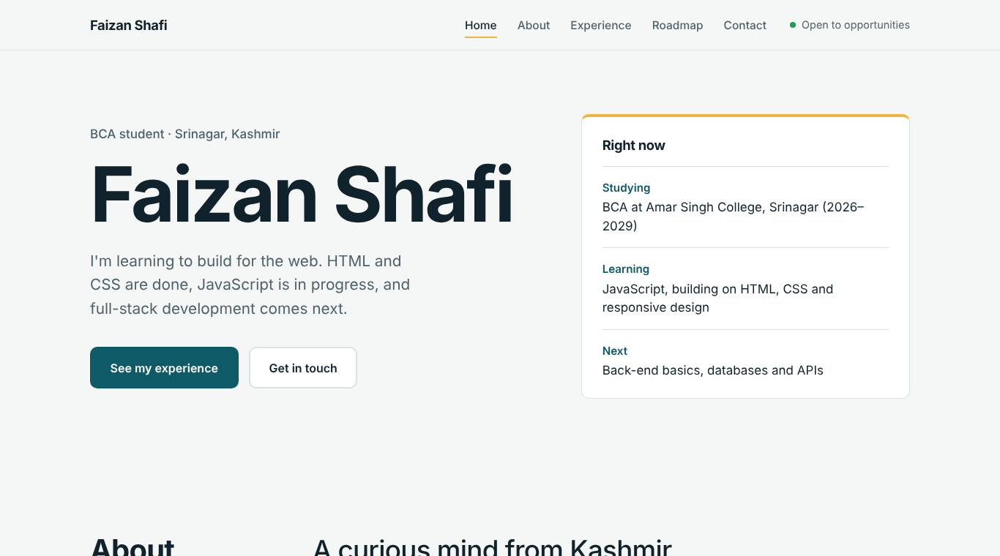

# Faizan Shafi — Portfolio

A responsive, single-page portfolio built with plain **HTML, CSS and JavaScript**. No frameworks and no build step: open `index.html` and it works.



**Live site:** _add your link after deploying (see [Deployment](#deployment))_

## About the site

This is the personal site of Faizan Shafi, a BCA student at Amar Singh College, Srinagar, who is learning web development. It presents who he is, what he has worked on, and where he is heading.

| Section | What it shows |
| --- | --- |
| Hero | Name, a one-line summary and a "Right now" card (studying, learning, next) |
| About | Short bio and a skills list with honest levels (Completed, Learning, Foundational, Basic) |
| Experience | Work at Ematrix Software Solutions (EmvoraERP), plus independent and team projects, each with its own write-up |
| Roadmap | Four-step career path from front-end foundations to forward deployed engineering |
| Contact | Email and GitHub links |

## Features

- **Experience-first design:** the Experience section is a full-width colour band, with a featured card for professional work and a short paragraph for every entry
- **Light and dark themes** that follow the visitor's system setting
- **Fully responsive** layout, tested from phone width up to desktop
- **Accessible by default:** skip link, semantic landmarks, visible keyboard focus, labelled mobile menu (`aria-expanded`, closes with Esc) and `prefers-reduced-motion` support
- **Active-section highlight** in the navigation while scrolling
- **Gentle reveal-on-scroll** using `IntersectionObserver` (disabled for reduced-motion users)
- **Standard cursor** and no loading screen, so nothing gets in the way of the content

## Tech stack

| Area | Details |
| --- | --- |
| Markup | Semantic HTML5 |
| Styling | CSS custom properties, Grid, Flexbox, `color-mix()`, `prefers-color-scheme` |
| Behaviour | Vanilla JavaScript (ES6+) |
| Fonts | [Bricolage Grotesque](https://fonts.google.com/specimen/Bricolage+Grotesque) and [Source Sans 3](https://fonts.google.com/specimen/Source+Sans+3) via Google Fonts, with system-font fallbacks |

## Project structure

```
myResume/
├── index.html      # Page content and structure
├── style.css       # Design tokens, layout, themes, responsive rules
├── script.js       # Mobile menu, active nav link, reveal on scroll, footer year
├── assets/
│   └── preview.png # Screenshot used in this README
└── README.md
```

## Run locally

```bash
git clone https://github.com/faizanshafi25/MyResume.git
cd MyResume

# Option 1: just open index.html in your browser
# Option 2: serve it locally
python -m http.server 8000      # then visit http://localhost:8000
```

## Customise

**Colours.** All colours are tokens at the top of `style.css`. Light values are in `:root`; dark values are in the `prefers-color-scheme: dark` block directly below.

```css
:root {
    --bg: #f5f7f6;       /* page background */
    --primary: #0e5a66;  /* Dal Lake teal */
    --saffron: #f2b53a;  /* accent */
    --band: #0b3f49;     /* Experience section background */
}
```

**Add an experience entry.** Copy an existing `<article class="role reveal">` in `index.html` and change the title, organisation, badge and paragraph. Aim for a 5–7 line paragraph at desktop width. Put professional work under **Work** and everything else under **Independent & team projects**.

**Roadmap.** Copy a `<li class="timeline-item reveal">`. Add `is-current` for the active step, and use `status-active`, `status-next` or no modifier for the label.

## Deployment

Because the site is static, any static host works.

**GitHub Pages:** open the repository on GitHub, go to *Settings → Pages*, choose *Deploy from a branch*, select `main` and `/ (root)`, then save. The site will be served at `https://faizanshafi25.github.io/MyResume/`.

**Netlify or Vercel:** import the repository. No build command is needed, and the publish directory is the project root.

## Browser support

Current versions of Chrome, Edge, Firefox and Safari.

## Contact

- GitHub: [@faizanshafi25](https://github.com/faizanshafi25)
- Email: hello@faizanshafi.dev

## License

All rights reserved © 2026 Faizan Shafi. If you want others to reuse the code, add a licence file such as MIT.
